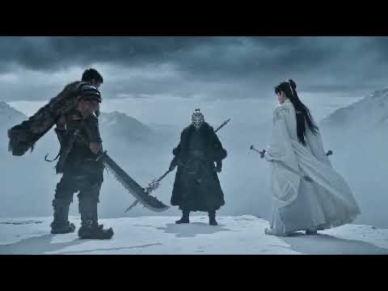

# 仙灵音乐

<picture>
  <source media="(prefers-color-scheme: dark)" srcset="https://cdn.jsdelivr.net/gh/webkubor/free-imgbed@main/xianling-music/logo-dark.svg">
  
</picture>

做音乐，也做让音乐创作更自由的工具。

## 音乐作品

### 《沸腾之雪》

风雪与江湖里的故事。**[在网易云音乐听完整专辑](https://music.163.com/#/album?id=361519698)**

🎵 [沸腾之雪](https://music.163.com/#/song?id=3349600888) · [雪沸·命如刃](https://music.163.com/#/song?id=3349019369) · [残雪·杯中冷](https://music.163.com/#/song?id=3348498391)

### 《雪夜无名》

雪夜里的故事。**[在网易云音乐听完整专辑](https://music.163.com/#/album?id=368403271)**

🎵 [雪夜无名](https://music.163.com/#/song?id=3364599642) · [照雪的人](https://music.163.com/#/song?id=3364616942) · [落雪](https://music.163.com/#/song?id=3364621271)

## 音乐走进短剧

仙灵音乐的作品用作武侠短剧 **《沸腾之雪》** 的背景音乐。看故事，也听音乐在画面里的样子。

[▶ 在 YouTube 看《沸腾之雪》正片合集](https://www.youtube.com/playlist?list=PLwlelKMz3R8wCVkYdhVawo4qJlcLMbgkH) · [观看世界观先导 MV](https://www.youtube.com/watch?v=moY8csK_i9k)

也可以在 **微信视频号** 和 **小红书** 搜索「沸腾之雪」。

## 音乐创作工具

### [简谱编辑器](https://github.com/xianling-music/jianpu-editor)

在浏览器里写简谱、试听和分享，支持 MIDI 导入导出及 WAV 导出。

[在线使用](https://jianpu.webkubor.online/) · [查看源码](https://github.com/xianling-music/jianpu-editor)

### [VoxFlow](https://github.com/xianling-music/voxflow)

面向 Apple Silicon 的 AI 音频工作台，在本机做文字转语音、声音克隆和音色设计，也支持 Suno 音乐生成。

[了解 VoxFlow](https://github.com/xianling-music/voxflow)

---

[仙灵音乐官网](https://music.museav.top/) · [合作品牌 Museav](https://www.museav.top/)
